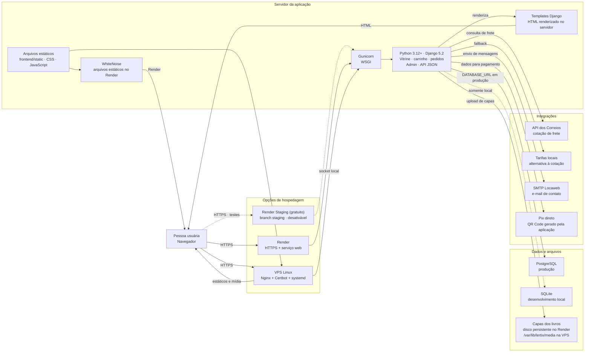
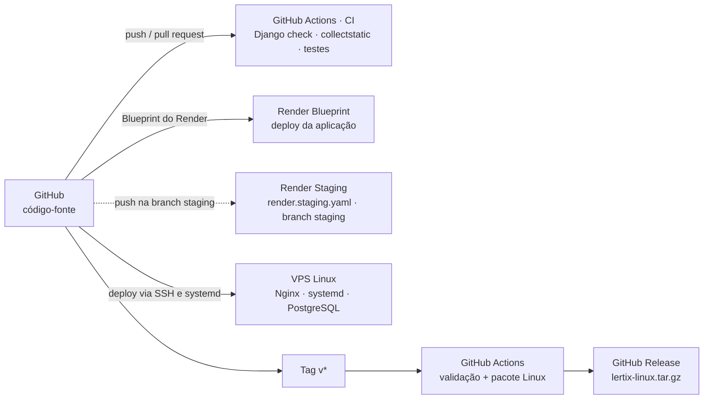

# Stack do Lertix

Diagrama do stack da aplicação e das opções de publicação presentes no
repositório. Render e VPS são alternativas de produção; SQLite é usado apenas
no desenvolvimento local.

## Aplicação e infraestrutura

No Render, o serviço web usa Gunicorn, WhiteNoise, PostgreSQL gerenciado e, na
configuração de produção, um disco persistente para as capas. Na VPS, Nginx
termina HTTPS e entrega estáticos e mídia; Gunicorn atende o Django por socket
local e o PostgreSQL roda na própria VPS.

O ambiente de staging (`render.staging.yaml`) publica a branch `staging` no plano
gratuito do Render para testar funcionalidades novas. Após o go-live na Locaweb
ele é suspenso (Suspend), sem ser removido, e reativado quando necessário.

O Pix é gerado diretamente pela aplicação; não há intermediador de pagamento.
O frete consulta os Correios quando configurado e pode recorrer às tarifas
mantidas no admin.

## CI e publicação

